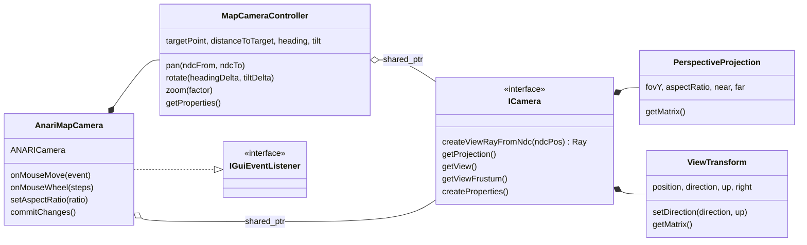
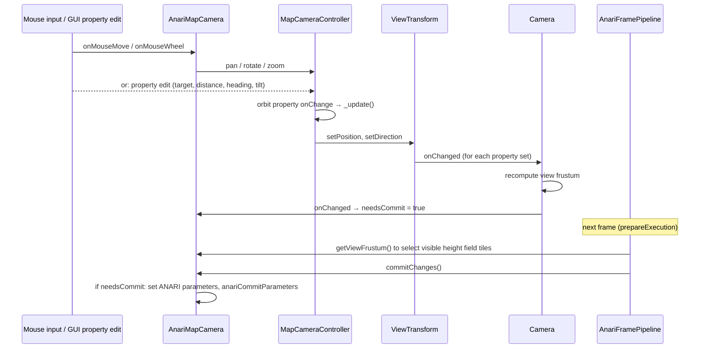

# Camera

This document describes the camera classes: what each one is responsible for, why they are split that way, how changes flow between them, and how to use them with a renderer.

- [Camera](#camera)
  - [Overview](#overview)
  - [Classes](#classes)
    - [`PerspectiveProjection` and `ViewTransform`](#perspectiveprojection-and-viewtransform)
    - [`ICamera`](#icamera)
    - [`MapCameraController`](#mapcameracontroller)
    - [`AnariMapCamera`](#anarimapcamera)
  - [Why it is split this way](#why-it-is-split-this-way)
  - [Change flow](#change-flow)
  - [Navigation](#navigation)
    - [Orbit state](#orbit-state)
    - [Operations](#operations)
    - [Mouse bindings in the viewer](#mouse-bindings-in-the-viewer)
  - [Properties](#properties)
  - [Using the camera](#using-the-camera)
    - [With another renderer](#with-another-renderer)
    - [In tests](#in-tests)
  - [Known limitations](#known-limitations)

## Overview

The camera is split between two libraries:

| Class                                    | Library      | Responsibility                                                                          |
| ---------------------------------------- | ------------ | --------------------------------------------------------------------------------------- |
| `PerspectiveProjection`, `ViewTransform` | `im3e_scene` | Hold the projection and view parameters as properties and compute their matrices.       |
| `ICamera` (`Camera`)                     | `im3e_scene` | Combines a projection and a view, keeps the view frustum up to date, creates view rays. |
| `MapCameraController`                    | `im3e_scene` | Keeps a map-style orbit state and writes the camera's view from it.                     |
| `AnariMapCamera`                         | `im3e_anari` | Maps mouse input to controller operations, and pushes the camera to ANARI.              |



## Classes

### `PerspectiveProjection` and `ViewTransform`

[perspective_projection.h](../../im3e/scene/lib/include/im3e/scene/perspective_projection.h) and [view_transform.h](../../im3e/scene/lib/include/im3e/scene/view_transform.h) store their parameters as `PropertyValue`s, so the GUI can show them without extra code. Their matrices are computed lazily by `getMatrix()`, and cached until a parameter changes.

- `PerspectiveProjection` holds the vertical field of view (radians), aspect ratio, near and far distances. The projection follows the conventions of [Coordinate Spaces](coordinate_spaces.md).
- `ViewTransform` holds the position and an orthonormal basis (`direction`, `up`, `right`). `setDirection(direction, up)` derives `right` and re-orthogonalizes `up`, so callers only need an approximate up vector.

Each one takes an `onChanged` callback, called whenever one of its parameters changes. Both are owned by a camera and cannot be copied or moved, because their property callbacks capture `this`.

### `ICamera`

[camera.h](../../im3e/scene/lib/include/im3e/scene/camera.h) declares the interface and its factory, `createCamera(onChanged)`. The implementation, `Camera`, owns a `PerspectiveProjection` and a `ViewTransform`, and on each change of either one:

1. recomputes its `ViewFrustum` (used by renderers to cull tiles),
2. calls its own `onChanged` callback, so that its owner knows the camera must be synced to the renderer.

`createViewRayFromNdc(ndcPos)` returns the ray from the camera position through a point of the viewport given in NDC. It is how screen positions are mapped into the scene, e.g. to pan.

`ICamera` is an interface only so that `MapCameraController` can be tested against `MockCamera`. Callers access the projection and view directly through `getProjection()` and `getView()` to change them.

### `MapCameraController`

[map_camera_controller.h](../../im3e/scene/lib/include/im3e/scene/map_camera_controller.h) navigates a camera above a map. It holds the orbit state described in [Navigation](#navigation), as properties, and each time one of them changes it recomputes the camera's position and direction. The controller never reads the view back: the orbit state is the single source of truth, and the view transform is derived from it.

The controller has no GUI dependency: it exposes operations (`pan`, `rotate`, `zoom`) instead of event handlers. Deciding which input triggers which operation is the job of its owner.

### `AnariMapCamera`

[anari_map_camera.h](../../im3e/anari/src/anari_map_camera.h) is the ANARI adapter, internal to `im3e_anari`. `AnariFramePipeline` creates it and gives it to the application as the `IGuiEventListener` of the render panel (`IAnariFramePipeline::getCameraListener()`). It:

- creates the `ICamera` and a `MapCameraController` on it,
- implements `IGuiEventListener` and maps mouse input to controller operations (see [Mouse bindings](#mouse-bindings-in-the-viewer)),
- owns the `ANARICamera`, and in `commitChanges()` sets its parameters (`fovy`, `aspect`, `near`, `far`, `position`, `up`, `direction`) only when the camera changed since the last commit,
- receives the aspect ratio of the render panel from `AnariFramePipeline` through `setAspectRatio()`.

## Why it is split this way

- **Renderer independence.** Everything except the ANARI calls is in `im3e_scene`, so a future renderer only needs a small adapter like `AnariMapCamera`.
- **One source of truth.** The view transform's properties are read-only in the GUI. The orbit state is the only editable description of where the camera is.
- **Testability.** The navigation logic is unit tested without ANARI or a GUI.
- **Other controllers.** A different navigation style (e.g. first person) is another controller writing to the same `ICamera`.

## Change flow

All changes go through properties and their `onChange` callbacks. Nothing polls: the camera is up to date as soon as a parameter changes, and the renderer is synced once per frame.



The aspect ratio follows the same path from `PerspectiveProjection`: `AnariFramePipeline` calls `AnariMapCamera::setAspectRatio` when the panel is resized, which marks the camera for commit.

Changes are only pushed to ANARI from `commitChanges()`, which the frame pipeline calls between frames, following the commit model described in [Shared design patterns](index.md#shared-design-patterns).

## Navigation

### Orbit state

The scene is Y-up, and the map lies in the horizontal XZ plane. The controller describes the camera relative to a point of the map:

| Parameter            | Unit        | Range    | Meaning                                                                                                              |
| -------------------- | ----------- | -------- | -------------------------------------------------------------------------------------------------------------------- |
| `Target Point`       | scene units |          | The point the camera looks at. Its height (y) defines the plane used to pan.                                         |
| `Distance to Target` | scene units | > 0      | Distance from the camera to the target point.                                                                        |
| `Heading`            | radians     | [-π, π]  | Rotation around the vertical axis. At 0, the top of the screen points towards -z (north of the map).                 |
| `Tilt`               | radians     | [0, 70°] | Angle from the vertical. At 0 the camera looks straight down; when tilted, it moves away from north and looks north. |

From these, the controller computes:

```
rotation  = rotateY(heading) * rotateX(tilt)
direction = rotation * (0, -1, 0)
up        = rotation * (0, 0, -1)
position  = target - direction * distance
```

Values outside a property's range are clamped by the property.

### Operations

- **`pan(ndcFrom, ndcTo)`** casts view rays through both NDC positions and intersects them with the horizontal plane at the target's height. The target moves by the difference, so the map point under `ndcFrom` ends up under `ndcTo`. The target's height does not change. If either ray points up or grazes the plane (above the horizon), nothing happens.
- **`rotate(headingDelta, tiltDelta)`** adds the deltas in radians. The heading wraps around to stay in [-π, π], the tilt is clamped to its range.
- **`zoom(factor)`** multiplies the distance to the target by `factor`, which must be greater than 0 (it throws `std::invalid_argument` otherwise). A factor below 1 moves closer. Because the distance is multiplied, it never reaches 0 through `zoom`.

### Mouse bindings in the viewer

`AnariMapCamera` maps mouse input to these operations. Mouse positions arrive in NDC (see [Use in GUI events](coordinate_spaces.md#use-in-gui-events)).

| Input                     | Operation                                                                                                        |
| ------------------------- | ---------------------------------------------------------------------------------------------------------------- |
| Left drag                 | `pan`: the point under the cursor follows it.                                                                    |
| Ctrl + left drag          | `rotate`: a drag across the full viewport width turns the heading by 360°, across the full height tilts by 180°. |
| Mouse wheel               | `zoom`: each step changes the distance by 10% (factor `1 - 0.1 × steps`, at least 0.1).                          |
| Mouse move without button | nothing                                                                                                          |

## Properties

`AnariMapCamera::createProperties()` (exposed as `IAnariFramePipeline::createCameraProperties()`) returns this group, which the viewer shows in its parameters panel:

```
Map Camera
├── Map Camera Controller     editable: Target Point, Distance to Target, Heading, Tilt
└── Camera
    ├── Perspective Projection    editable: FOV Y, Near, Far; read-only: Aspect Ratio
    └── View Transform            read-only: Position, Direction, Up, Right
```

The aspect ratio is read-only because it follows the size of the render panel. The view transform is read-only because it is derived from the orbit state.

## Using the camera

### With another renderer

A renderer adapter follows the pattern of `AnariMapCamera`: it creates the camera with a callback that marks it dirty, drives it with a controller, and syncs it once per frame.

```cpp
#include <im3e/scene/camera.h>
#include <im3e/scene/map_camera_controller.h>

class MyRendererCamera
{
public:
    MyRendererCamera()
      : m_pCamera(createCamera([this] { m_isDirty = true; }))
      , m_controller(m_pCamera)
    {
    }

    void onResize(float aspectRatio) { m_pCamera->getProjection().setAspectRatio(aspectRatio); }

    void sync()  // once per frame, between frames
    {
        if (!m_isDirty)
        {
            return;
        }
        m_isDirty = false;
        uploadMatrices(m_pCamera->getProjection().getMatrix(), m_pCamera->getView().getMatrix());
    }

    auto getController() -> MapCameraController& { return m_controller; }
    auto getViewFrustum() const -> const ViewFrustum& { return m_pCamera->getViewFrustum(); }

private:
    bool m_isDirty{true};
    std::shared_ptr<ICamera> m_pCamera;
    MapCameraController m_controller;
};
```

Declare the camera before the controller: the controller takes it in its constructor and writes its view right away.

Matrices follow GLM's conventions (right-handed, depth in [0, 1]). A Vulkan renderer must flip y, see [Coordinate Spaces](coordinate_spaces.md).

### In tests

`mock_im3e_scene` provides `MockCamera` ([mock_camera.h](../../im3e/scene/mock/include/im3e/scene/mock_camera.h)), to test code that drives an `ICamera` without real projection and view computations. The unit tests of the camera classes are in [im3e/scene/test/unit/](../../im3e/scene/test/unit/).

## Known limitations

- **Initial state.** The controller starts at a hard-coded target `(3700, 0, 4000)` and distance 5000, chosen for one test data set. It should be configurable, or derived from the bounds of the height map.
- **Input bindings in the renderer module.** The mouse bindings live in `AnariMapCamera`, so a new renderer adapter would duplicate them. They belong in the GUI layer, as an `IGuiEventListener` that drives a `MapCameraController`.
- **Distance has no lower bound** when edited as a property: `zoom` keeps it positive, but the GUI accepts 0 or negative values.
- **Camera owned by the frame pipeline.** `AnariFramePipeline` creates its `AnariMapCamera`, so a camera cannot be shared between views or outlive the pipeline (finding O2 of the [Architecture Review](../work_in_progress/architecture_review.md#ownership)).
