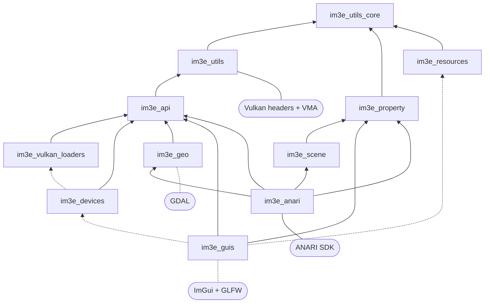
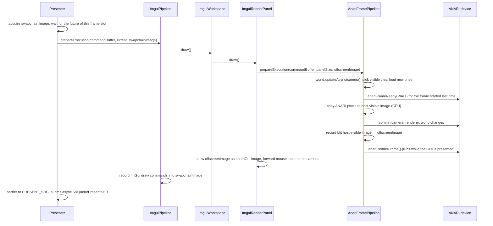

# Architecture

This document describes how IcyMoon is structured: the libraries it is made of, how they depend on each other, the patterns they share, and how a frame flows through them at run time. 

- [Architecture](#architecture)
  - [Overview](#overview)
  - [Repository layout](#repository-layout)
  - [Libraries](#libraries)
    - [Dependency graph](#dependency-graph)
    - [Summary](#summary)
    - [Foundation: `im3e_utils_core`, `im3e_utils`, `im3e_property`](#foundation-im3e_utils_core-im3e_utils-im3e_property)
    - [Interfaces: `im3e_api`](#interfaces-im3e_api)
    - [GPU device: `im3e_devices` and `im3e_vulkan_loaders`](#gpu-device-im3e_devices-and-im3e_vulkan_loaders)
    - [Geospatial data: `im3e_geo`](#geospatial-data-im3e_geo)
    - [Scene: `im3e_scene`](#scene-im3e_scene)
    - [Windows and GUI: `im3e_guis`](#windows-and-gui-im3e_guis)
    - [Rendering: `im3e_anari`](#rendering-im3e_anari)
    - [Resources: `im3e_resources`](#resources-im3e_resources)
    - [OpenUSD: `im3e/usd`](#openusd-im3eusd)
    - [Test support: `im3e_test_utils` and mocks](#test-support-im3e_test_utils-and-mocks)
  - [Applications](#applications)
  - [Shared design patterns](#shared-design-patterns)
  - [Run-time flow of a frame](#run-time-flow-of-a-frame)
  - [Build system and tooling](#build-system-and-tooling)
  - [Known gaps and work in progress](#known-gaps-and-work-in-progress)

## Overview

IcyMoon (namespace `im3e`, "IcyMoon Engine") is a C++20 library for interactive 3D visualization of geospatial data, primarily large terrain height maps (DEMs, LiDAR rasters). It is built around three technologies:

- **Vulkan** for GPU resources, command submission and presentation to windows.
- **ANARI** (Khronos' Analytic Rendering Interface) for scene description and rendering. The ANARI implementation is chosen at run time: VisRTX (NVIDIA, ray-traced) when available, otherwise Helide (the CPU reference device).
- **GDAL** for reading geospatial rasters (GeoTIFF) and their overview pyramids.

The GUI uses GLFW for windows and input, and Dear ImGui for panels and docking.

The long-term goal is to use IcyMoon as a library from other languages, Python first (see [Library code](../development/code_standards.md#library-code) in the code standards). This is why the public surface is made of abstract interfaces and factory functions, and why library code avoids process-wide state.

## Repository layout

| Path                  | Content                                                                                                               |
| --------------------- | --------------------------------------------------------------------------------------------------------------------- |
| `im3e/`               | The library, split into one CMake target per subfolder (see [Libraries](#libraries)).                                 |
| `applications/`       | Executables built on the library: the ANARI viewer and smaller tools and samples (see [Applications](#applications)). |
| `external/imgui/`     | Dear ImGui, as a git submodule, built as the static `imgui` target with its GLFW and Vulkan back-ends.                |
| `resources/`          | Build-time resources from dependencies: copies PROJ's `proj.db`, which GDAL needs, next to the executables.           |
| `cmake/`              | CMake helpers: test and mock targets, code coverage, copy of DLLs on Windows.                                         |
| `recipes/`            | Local Conan recipes for dependencies that ConanCenter does not provide as we need them: ANARI SDK and OpenUSD.        |
| `profiles/`           | Conan profiles, composed per OS, compiler and variant (see [profiles/README.md](../../profiles/README.md)).           |
| `devtools/`, `dev.py` | Python developer CLI: `setup`, `install` and `lock` (see the [README](../../README.md#devpy-commands)).               |
| `.github/`            | CI workflows (see [GitHub Actions](../development/github_actions.md)).                                                |
| `docs/`               | Project documentation (see the [index](../index.md)).                                                                 |

Every header is included through its path from the repository root, e.g. `#include <im3e/geo/geo.h>`: each target adds the root folder (`IM3E_INCLUDE_DIR`) to its public include directories.

## Libraries

Each folder under `im3e/` follows the same layout:

```
im3e/<module>/
  <module>.h          public header: interfaces and factory functions
  src/                implementation, private to the target
  test/               unit tests (test_<name>.cpp)
  test/integration/   integration tests that need a GPU or a window (integration_<name>.cpp)
  mock/               GoogleMock implementations of the module's interfaces, when other modules need them
```

### Dependency graph

Public (transitive) dependencies are solid arrows, private ones are dashed. Third-party libraries are shown where they matter to the design.



There are no cycles. `im3e_api` is the hub: modules talk to each other through its interfaces, so `im3e_anari` does not know about `im3e_guis` and vice versa. The places where a module depends on another's implementation are:

- `im3e_guis` links `im3e_devices` privately, because `GlfwWindowApplication` creates the Vulkan device itself.
- `im3e_anari` links `im3e_geo` publicly, for the height map quad tree used to pick visible tiles.
- `im3e_anari` links `im3e_scene` publicly, for the renderer-independent camera.

### Summary

| Target                      | Kind      | Role                                                                                         | Key third-party dependencies |
| --------------------------- | --------- | -------------------------------------------------------------------------------------------- | ---------------------------- |
| `im3e_utils_core`           | static    | Lowest-level helpers with no graphics dependency: flags, paths, errors, platform.            | fmt, whereami                |
| `im3e_property`             | static    | Property interfaces and implementations, groups, change notification.                        | fmt                          |
| `im3e_utils`                | static    | Logging, stats, math, rays, view frustum, Vulkan helpers.                                    | glm, Vulkan headers, VMA     |
| `im3e_api`                  | interface | Abstract interfaces shared between modules: device, images, commands, frame pipeline, GUI.   | glm                          |
| `im3e_vulkan_loaders`       | object    | Loads the Vulkan library at run time and resolves function pointers.                         | Vulkan headers               |
| `im3e_devices`              | static    | Vulkan implementation of `IDevice`: instance, device, queue, images, memory.                 | VMA, CImg                    |
| `im3e_geo`                  | static    | Height maps from GeoTIFF files, tile pyramid, quad tree for visibility.                      | GDAL                         |
| `im3e_scene`                | static    | Renderer-independent camera: projection, view transform, map camera controller.              | glm                          |
| `im3e_guis`                 | default   | GLFW windows, swapchain presentation, ImGui workspace and panels.                            | GLFW, ImGui                  |
| `im3e_anari`                | static    | ANARI engine, world, camera, renderer and frame pipeline.                                    | ANARI SDK                    |
| `im3e_resources`            | interface | Generated header giving the paths of fonts and assets; copies the GUI font next to binaries. |                              |
| `im3e_test_utils`           | static    | Test fixtures and GoogleTest printers/matchers for Vulkan and GLM types.                     | GoogleTest                   |
| `mock_im3e*`                | static    | GoogleMock implementations of the interfaces.                                                | GoogleMock                   |

### Foundation: `im3e_utils_core`, `im3e_utils`, `im3e_property`

**`im3e_utils_core`** ([im3e/utils/core/](../../im3e/utils/core/)) holds what every other target can use without pulling graphics headers:

- `flags.h`: type-safe bit flags over enums (`Flags<E>`, enabled per enum with `IsFlagEnum<E>`).
- `throw_utils.h`: `throwIfNull`, `throwIfFalse`, `throwIfArgNull`... used for argument checking in constructors.
- `types.h`: `UniquePtrWithDeleter<T>` (a `unique_ptr` with a `std::function` deleter), used everywhere to own C handles from Vulkan, ANARI, GDAL and GLFW.
- `path_utils.h`: UTF-8 ⇄ `std::filesystem::path` conversions that do not depend on the Windows code page.
- `platform_utils.h`: `getCurrentExecutableFolder()`.

**`im3e_utils`** ([im3e/utils/](../../im3e/utils/)) adds the services used across modules:

- `loggers.h`: `ILogger` with hierarchical children (`createChild`) and trackers that collect errors from a logger tree (used by tests to fail on logged errors). Implementations: terminal and file loggers.
- `stats.h`: `IStatsProvider` records nested timing spans per thread (`startScopedSpan`), forwarded to `IStatsReceiver`s. The stats panel of the GUI is one such receiver.
- `path.h`: `Path`, an absolute path in a tree of named nodes (`/camera/view`) that always uses `/`, unlike `std::filesystem::path`.
- `math_utils.h`: `TileID` (`u16vec3`: x, y, level of detail) and small math helpers.
- `ray.h`, `view_frustum.h`, `transform.h`: rays, frustum culling, TRS transforms. Conventions are in [Coordinate Spaces](coordinate_spaces.md).
- `vk_utils.h`: `VkUniquePtr`/`VkSharedPtr` for Vulkan handles, `throwIfVkFailed`, `getVkList`, and formatting of Vulkan enums.
- `imgui_utils.h`: header-only helpers for ImGui.

**`im3e_property`** ([im3e/property/](../../im3e/property/)) is a small reflection system that lets objects expose editable parameters without knowing the GUI:

- `IPropertyValue` exposes a value as `std::any`, with its type, name, description and optional min/max. `IPropertyGroup` is a named tree of properties.
- `PropertyValue<T>` implements it, with a runtime config and an optional `onChange` callback for the owner. Listeners subscribe through `registerOnChange` with a `weak_ptr` to a callback, so they unsubscribe by just dropping the callback.
- `createReadOnlyPropertyValueProxy` exposes a value without allowing writes.

`im3e_guis` draws any property group (`ImguiPropertyPanel`, `ImguiPropertyControl`) through the interfaces only. ANARI objects (camera, renderer, height fields, planes) publish their parameters this way. See [Properties](properties.md) for the details.

### Interfaces: `im3e_api`

[im3e/api/](../../im3e/api/) is header-only. It defines the contracts between modules:

| Header               | Interfaces                                                                                                                                                                                              |
| -------------------- | ------------------------------------------------------------------------------------------------------------------------------------------------------------------------------------------------------- |
| `device.h`           | `IDevice`: Vulkan handles and function tables, semaphores and fences, image factory, command queue, logger and stats factories.                                                                         |
| `image.h`            | `IImage`, `IHostVisibleImage` (CPU mapping), `IImageView`, `IImageMetadata` (current layout and access, for automatic barriers), `IImageFactory`.                                                       |
| `command_buffer.h`   | `ICommandQueue::startScopedCommand` returns a command buffer that is submitted when it goes out of scope, sync or async. `ICommandBuffer` records scoped image barriers and creates futures to wait on. |
| `frame_pipeline.h`   | `IFramePipeline`: records the commands that render a frame into an output image, and handles resizes.                                                                                                   |
| `gui.h`              | `IGuiPanel`, `IGuiWorkspace` (panels docked at a location), `IGuiEventListener` (mouse events in NDC).                                                                                                  |
| `window.h`           | `IWindowApplication`: creates windows for workspaces and runs the event loop.                                                                                                                           |
| `height_map.h`       | `IHeightMap` (size, tile size, levels of detail, min/max height) and `IHeightMapTileSampler`.                                                                                                           |
| `vulkan_functions.h` | `VulkanGlobalFcts`, `VulkanInstanceFcts`, `VulkanDeviceFcts`: tables of the Vulkan functions the project uses.                                                                                          |

`IFramePipeline` is the central abstraction: the ImGui GUI, the ANARI renderer and the test pipelines all implement it, and they can be nested (the ImGui pipeline draws a render panel, which runs an ANARI pipeline into an offscreen image).

### GPU device: `im3e_devices` and `im3e_vulkan_loaders`

[im3e/devices/](../../im3e/devices/) implements `IDevice` with Vulkan. Its public header only exposes `createDevice(logger, DeviceConfig)`; the config carries the debug flag, a callback to check presentation support (provided by GLFW) and the instance extensions the window system needs.

Internally:

- `VulkanInstance` creates the instance, with validation layers and a `VulkanDebugMessageHandler` that forwards validation messages to the logger when debug is enabled.
- `VulkanPhysicalDevices` ranks the physical devices (discrete GPUs first, required extensions and queues present) and picks a queue family supporting graphics and, when a presentation check is given, presentation.
- `VulkanDevice` owns the logical device, a single `VulkanCommandQueue`, the VMA-based memory allocator and the image factory.
- `VulkanImages` creates device-local images, host-visible (linear, mappable) images and proxies for images the device does not own (swapchain images). Each image tracks its layout and last access in `IImageMetadata`, so barriers only need the destination state.
- `VulkanCommandBuffer` and `VulkanCommandQueue` implement scoped recording, submission with wait/signal semaphores and fence-based futures.

**`im3e_vulkan_loaders`** ([im3e/devices/vulkan_loaders/](../../im3e/devices/vulkan_loaders/)) loads `vulkan-1.dll` / `libvulkan.so.1` at run time and resolves the function tables of `vulkan_functions.h`, plus the function table VMA needs. The whole project is compiled with `VK_NO_PROTOTYPES`: no code calls Vulkan through the loader's exported symbols, every call goes through `IDevice::getFcts()` or `getInstanceFcts()`. This keeps Vulkan an optional run-time dependency and makes Vulkan calls mockable in unit tests (`mock_im3e_vulkan_loaders`, `MockVulkanFunctions`).

### Geospatial data: `im3e_geo`

[im3e/geo/](../../im3e/geo/) turns raster files into the `IHeightMap` interface:

- `loadHeightMapFromFile(logger, {path, readOnly})` opens a GeoTIFF with GDAL (`GdalGeoTiffHeightMap`). Tiles follow the file's block size, and levels of detail map to the file's overviews. When opened writable, `rebuildPyramid()` regenerates the overviews.
- Tile samplers read one tile of one level of detail and report invalid (no-data) samples.
- `getGdalInstance` returns a shared GDAL initialization (a mutex-guarded `weak_ptr` singleton), so that `GDALAllRegister()` runs once while height maps are alive.
- `generateHeightMapQuadTree` builds a quad tree of world-space bounding boxes over the tile pyramid. `HeightMapQuadTreeNode::findVisible(frustum, lod)` returns the tiles of a level of detail that intersect a view frustum.

### Scene: `im3e_scene`

[im3e/scene/](../../im3e/scene/) holds the parts of the scene that do not depend on a renderer.
For now it contains the camera:

- `PerspectiveProjection` and `ViewTransform` hold the projection and view parameters as properties, and compute their matrices.
- `ICamera` (created by `createCamera`) combines them, keeps a `ViewFrustum` up to date and creates view rays from NDC positions.
- `MapCameraController` keeps a map-style orbit state (target point, distance, heading, tilt) and writes the camera's view from it. It offers navigation operations (`pan`, `rotate`, `zoom`) and does not depend on the GUI.

`mock_im3e_scene` provides `MockCamera`. See [Camera](camera.md) for the responsibilities, the change flow and how to use these classes.

### Windows and GUI: `im3e_guis`

[im3e/guis/](../../im3e/guis/) provides the windowing application and ImGui panels. Its public header has factory functions only:

| Factory                       | Creates                                                                                                                                            |
| ----------------------------- | -------------------------------------------------------------------------------------------------------------------------------------------------- |
| `createGlfwWindowApplication` | `GlfwWindowApplication`: initializes GLFW, creates the `IDevice`, owns windows and runs the loop.                                                  |
| `createImguiWorkspace`        | `ImguiWorkspace`: a dock space with a center panel and panels docked top/bottom/left/right.                                                        |
| `createImguiRenderPanel`      | `ImguiRenderPanel`: runs any `IFramePipeline` into an offscreen image shown as an ImGui image, and forwards mouse input to an `IGuiEventListener`. |
| `createImguiPropertyPanel`    | `ImguiPropertyPanel`: draws and edits an `IPropertyGroup`.                                                                                         |
| `createImguiStatsPanel`       | `ImguiStatsPanel`: shows timing spans from an `IStatsProvider`.                                                                                    |
| `createImguiPipeline`         | `ImguiPipeline`: the `IFramePipeline` that renders a workspace.                                                                                    |

Inside, each `GlfwWindow` owns a Vulkan surface and a `Presenter`. The `Presenter` owns the swapchain, its semaphores and per-image command futures, and calls an `ImguiPipeline` to fill each swapchain image. The `ImguiPipeline` owns its own `ImguiContext` (one ImGui context per window, made current with a guard) and an `ImguiVulkanBackend` (render pass, framebuffer and descriptor pool for ImGui's Vulkan back-end).

### Rendering: `im3e_anari`

[im3e/anari/](../../im3e/anari/) wraps ANARI behind its own interfaces ([anari.h](../../im3e/anari/anari.h)):

| Interface             | Role                                                                                                                 | Implementation                   |
| --------------------- | -------------------------------------------------------------------------------------------------------------------- | -------------------------------- |
| `IAnariEngine`        | Loads an ANARI library and device; creates frame pipelines. Created by `createAnariEngine`.                          | `AnariEngine`                    |
| `IAnariFramePipeline` | An `IFramePipeline` that renders an ANARI frame; gives access to the world, the camera listener and property groups. | `AnariFramePipeline`             |
| `IAnariWorld`         | Adds objects to the scene: planes and height fields.                                                                 | `AnariWorld`                     |
| `IAnariObject`        | An object of the world exposing its properties.                                                                      | `AnariPlane`, `AnariHeightField` |

Internal classes:

- `AnariDevice` owns the `ANARIDevice` (wrapped in the ANARI debug device when debug is enabled), queries its extensions, and creates ANARI objects (arrays, geometries, materials, surfaces, groups, instances) as `UniquePtrWithDeleter`s.
- `AnariRenderer` owns the renderer. Its properties are generated from the parameters the ANARI implementation reports for the renderer subtype, so they differ between VisRTX and Helide.
- `AnariMapCamera` adapts the camera of `im3e_scene` to ANARI. It owns an `ICamera`, a `MapCameraController` and the `ANARICamera`. As an `IGuiEventListener`, it turns mouse drags and wheel steps into controller operations, and `commitChanges()` pushes the camera parameters to ANARI when they changed (see [Camera](camera.md)).
- `AnariWorld` owns the world, a directional light, and its objects. `AnariInstanceSet` collects the ANARI instances currently in the world, guarded by a mutex, and updates the world's `instance` array only when it changed.
- `AnariHeightField` streams an `IHeightMap` into the world. It owns a fixed pool of 100 `AnariHeightFieldTile`s. On each update, it asks the quad tree for the tiles visible at the selected level of detail, keeps tiles that are still visible, reuses pooled tiles that already hold the right data, and loads the others from the height map. Each tile is a triangle mesh in its own ANARI group and instance.
- `AnariPlane` is a simple scalable plane, e.g. for a ground.

The ANARI image reaches Vulkan through the CPU: `AnariFramePipeline` maps the ANARI color channel, copies it row by row (flipping it, as ANARI images start at the bottom) into a host-visible Vulkan image, and records a blit to the output image. See [Run-time flow of a frame](#run-time-flow-of-a-frame).

### Resources: `im3e_resources`

[im3e/resources/](../../im3e/resources/) generates `im3e/resources/resources.h` from `resources.h.in`. It gives the path of the GUI font, copied to `<bin>/fonts/` at build time, and of the `assets` and `images` folders, which are absolute paths into the source tree. The separate [resources/proj/](../../resources/proj/) target copies GDAL's `proj.db` next to executables that use GDAL.

### OpenUSD: `im3e/usd`

[im3e/usd/](../../im3e/usd/) is a placeholder: when OpenUSD is found, it only builds a test checking that OpenUSD can be used. OpenUSD is optional and not installed by `dev.py install` (see the [README](../../README.md#openusd)).

### Test support: `im3e_test_utils` and mocks

- [im3e/test_utils/](../../im3e/test_utils/) provides GoogleTest fixtures: `IntegrationTest` (logger whose errors fail the test), `DeviceIntegrationTest` (a real Vulkan device) and `PipelineIntegrationTest` (runs an `IFramePipeline` into an image and compares pixels). It also has printers and matchers for GLM, Vulkan and standard types.
- `mock_im3e` ([im3e/mock/](../../im3e/mock/)) mocks the `im3e_api` interfaces: device, images, command buffers, height maps, Vulkan function tables. `mock_im3e_utils` mocks loggers and stats, `mock_im3e_vulkan_loaders` mocks the loader.
- Test executables are declared with `im3e_add_unit_tests_executable` and `im3e_add_integration_tests_executable` ([cmake/im3e_tests.cmake](../../cmake/im3e_tests.cmake)), which label them for `ctest -L` and exclude them from coverage.

Current coverage by module: `utils`, `utils/core`, `devices` and `vulkan_loaders` have unit and integration tests; `property` and `scene` have unit tests; `geo` tests the quad tree; `guis` has integration tests only; `anari` has no tests yet.

## Applications

| Target               | Folder                                                           | Purpose                                                                                                                                                        |
| -------------------- | ---------------------------------------------------------------- | -------------------------------------------------------------------------------------------------------------------------------------------------------------- |
| `im3e_anari_viewer`  | [applications/anari/](../../applications/anari/)                 | The main application: loads a height map into an ANARI world and shows it with renderer, camera and height-field properties, a render panel and a stats panel. |
| `im3e_geo_processor` | [applications/geo_processor/](../../applications/geo_processor/) | Command-line tool: `info <file>` prints information about a raster, `rebuild <file>` regenerates its overviews (levels of detail).                             |
| `im3e_glfw_app`      | [applications/glfw_app/](../../applications/glfw_app/)           | Minimal sample: a window with an empty ImGui workspace.                                                                                                        |
| `im3e_usd_viewer`    | [applications/usd_viewer/](../../applications/usd_viewer/)       | Placeholder for a USD viewer; currently identical to `im3e_glfw_app`.                                                                                          |

The ANARI viewer shows how the library is meant to be assembled:

```cpp
auto pApp = createGlfwWindowApplication(*pLogger, {.name = "ANARI Viewer", .isDebugEnabled = true});
auto pEngine = createAnariEngine(*pLogger, pApp->getDevice(), true);
auto pFramePipeline = pEngine->createFramePipeline();
auto pHeightField = pFramePipeline->getWorld()->addHeightField(loadHeightMapFromFile(*pLogger, {.path = ...}));

auto pWorkspace = createImguiWorkspace("ANARI");
pWorkspace->addPanel(Location::Left, createImguiPropertyPanel(createPropertyGroup("Parameters", {...})));
pWorkspace->addPanel(Location::Center, createImguiRenderPanel("Renderer", std::move(pFramePipeline), pCameraListener));
pWorkspace->addPanel(Location::Bottom, createImguiStatsPanel("Stats", pDevice->getStatsProvider()));

pApp->createWindow({}, pWorkspace);
pApp->run();
```

## Shared design patterns

- **Interfaces and factory functions.** Public headers declare abstract `I*` classes and free `create*` functions returning smart pointers. Implementations live in `src/`, often in an anonymous namespace, and never appear in public headers. Clients, tests and future language bindings only depend on the interfaces.
- **Ownership with smart pointers.** Shared services (device, stats provider, workspace, panels) are `shared_ptr`s; exclusive ones (frame pipelines, images, loggers) are `unique_ptr`s. C handles from Vulkan, ANARI, GDAL and GLFW are owned by `UniquePtrWithDeleter`, `VkUniquePtr` or `VkSharedPtr` with the matching destroy call.
- **Constructor argument checks.** Constructors validate their dependencies with `throwIfArgNull` in the member initializer list, so an object is either fully built or not built.
- **Child loggers.** Each object creates a named child logger from its parent (`createChild`, `IDevice::createLogger`), giving messages a hierarchical origin.
- **Scoped operations.** Command recording, barriers and stats spans are RAII objects: submission, barrier emission and span end happen in their destructor.
- **Properties instead of GUI code.** Objects expose `IPropertyGroup`s; the GUI generates controls for them. Rendering code never includes ImGui.
- **Commit model.** ANARI objects accumulate parameter changes and apply them in `commitChanges()`, called by the frame pipeline between frames, never while ANARI is rendering.

The rules these patterns follow (naming, includes, error handling...) are in [Code Standards](../development/code_standards.md).

## Run-time flow of a frame

`GlfwWindowApplication::run()` polls GLFW events and calls `GlfwWindow::draw()` for each window, which calls `Presenter::present()`:



Notes:

- ANARI rendering overlaps with the rest of the frame: each `prepareExecution` displays the frame that ANARI started on the previous call, then starts the next one. The image shown is therefore one frame behind the camera.
- The `Presenter` keeps one command future per swapchain image and waits on it before reusing its slot, so the CPU never gets more than the swapchain image count ahead of the GPU.
- When the window is resized, or the swapchain becomes out of date or suboptimal, the `Presenter` waits for the queue to be idle, recreates the swapchain and calls `resize()` on its pipeline, which propagates `onWindowResized` to the workspace and its panels.
- Everything runs on the main thread. Only ANARI's own rendering runs in the background, inside the ANARI device.

## Build system and tooling

- **Conan 2** ([conanfile.py](../../conanfile.py)) provides the dependencies: ANARI SDK, CImg, fmt, GDAL (with PROJ), GLFW, GLM, Vulkan headers, VMA, whereami and GoogleTest. ANARI and OpenUSD use local recipes under `recipes/`. Versions are pinned in `conan.lock`.
- **CMake** (4.2, Ninja, C++20) builds the project from presets that `dev.py install` generates, one per configuration (`lnx-gcc-*`, `win-clang-*`). All warnings are errors (`-Wall -Wextra -pedantic -Werror` or `/W4 /WX`).
- **Executables and DLLs** are all built in `<build>/bin`. On Windows, `im3e_copy_runtime_dlls` and `im3e_copy_anari_devices` ([cmake/im3e_runtime_dlls.cmake](../../cmake/im3e_runtime_dlls.cmake)) copy the DLLs they need and the ANARI device plug-ins next to them.
- **Coverage**: lcov with GCC, source-based coverage with clang (see the [README](../../README.md#test-coverage-with-gcc)).
- **CI**: GitHub Actions build and test the configurations (see [GitHub Actions](../development/github_actions.md)).

The [README](../../README.md) has the build instructions.

## Known gaps and work in progress

Observations on the current state of the code, as input for future plans:

- **Library packaging.** There is no install or export of the `im3e_*` targets, no versioned public API and no language bindings yet. `im3e_guis` has no explicit library type, unlike the other targets. `resources.h` hard-codes source-tree paths for assets, which will not work once the library is installed elsewhere. `getGdalInstance` registers GDAL drivers process-wide, which a host process that also uses GDAL may not expect.
- **Interfaces that leak implementations.** `IDevice` exposes raw Vulkan handles and function tables, and `anari.h` includes `<anari/anari.h>`. `GlfwWindowApplication::createWindow` only accepts `ImguiWorkspace`s (checked with a `dynamic_pointer_cast`), and creates the device itself, so a host application cannot provide its own.
- **ANARI to Vulkan transfer.** Frames go through a CPU copy every frame. GPU interop (e.g. VisRTX's CUDA or Vulkan frame output) would remove it.
- **Threading.** `updateAsync` is synchronous: visible tiles are loaded from disk on the main thread, which stalls frames while streaming. `AnariInstanceSet` is already guarded by a mutex in preparation.
- **Height fields.** Frustum culling misses some tiles when changing levels of detail (TODO in [anari_height_field.cpp](../../im3e/anari/src/anari_height_field.cpp)); the tile pool size (100) and the level of detail are fixed rather than driven by screen-space error.
- **Single queue.** `IDevice` has one command queue used for everything.
- **Applications.** The ANARI viewer loads a hard-coded file path. `gdal_dem_loader` and `anari_dem_surface_generator` in `applications/anari/` are built but no longer used (superseded by `im3e_geo` and `AnariHeightField`). `im3e_usd_viewer` and `im3e/usd` are placeholders. ImPlot support is commented out.
- **Tests.** `im3e_anari` has no tests, and `im3e_geo` only tests the quad tree.
- **Windows support** is in progress.
