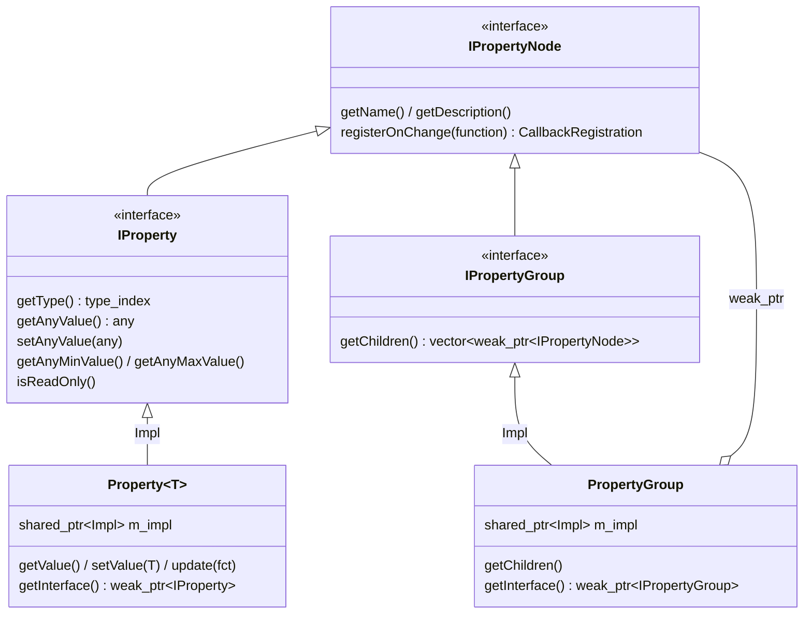

# Properties

This document describes the property system as it is today: the interfaces, the implementations, how owners declare and expose properties, how the GUI consumes them, and how ownership and change notification work. It ends with the known problems of the current design.

- [Properties](#properties)
  - [Overview](#overview)
  - [Intent and planned uses](#intent-and-planned-uses)
    - [Intent](#intent)
    - [Planned and possible uses](#planned-and-possible-uses)
    - [Requirements these uses imply](#requirements-these-uses-imply)
  - [Libraries](#libraries)
  - [Interfaces](#interfaces)
  - [Implementations](#implementations)
    - [`Property<T>`](#propertyt)
    - [`PropertyGroup`](#propertygroup)
  - [Usage by owners](#usage-by-owners)
    - [Static properties: `ViewTransform`](#static-properties-viewtransform)
    - [Dynamic properties: `AnariRenderer`](#dynamic-properties-anarirenderer)
    - [Composition into trees](#composition-into-trees)
  - [Usage by the GUI](#usage-by-the-gui)
  - [Ownership and lifetimes](#ownership-and-lifetimes)
  - [Change notification](#change-notification)
  - [Known problems](#known-problems)
  - [Possible improvements](#possible-improvements)
    - [Notify when a child is destroyed](#notify-when-a-child-is-destroyed)

## Overview

The property system is a small reflection layer. It lets an object expose some of its parameters, with a name, a description, a type and optional bounds, to code that does not know the object's type. Its only consumer today is the ImGui property panel, which draws and edits any property tree.

There are two kinds of nodes:

- A **property** (`IProperty`) holds one typed value, accessible type-erased through `std::any`.
- A **group** (`IPropertyGroup`) is a named list of child nodes, properties or groups, forming a tree.

Owners hold `Property<T>` and `PropertyGroup` as plain members. Each one keeps its state in a hidden, heap-allocated implementation, and hands out the interface as a `std::weak_ptr`.



## Intent and planned uses

### Intent

Properties are not a GUI feature. They are how an object holds the parts of its state it wants to expose, and they are the source of truth for that state:

- **They protect the data.** A property owns its value and enforces its rules, such as min/max bounds, whoever writes to it: the owner itself, im3e code, or user code.
- **They notify changes to anyone.** The owner reacts to external changes through the same mechanism as any other listener. For example, `ViewTransform` invalidates its matrix when one of its properties is changed from outside.
- **They are open to users.** A user can combine the properties im3e provides with their own in one tree, and build on top of it without knowing the concrete classes: their own UI, or any of the uses below.

The ImGui property panel is the first consumer, not the reason the system exists. Design choices should be judged against the uses below, not only against the GUI.

### Planned and possible uses

| Area                     | Use                                                                                           |
| ------------------------ | --------------------------------------------------------------------------------------------- |
| User interfaces          | im3e's ImGui panel, and UIs built by users from im3e's properties and their own.              |
| Observation              | Stats collection: read-only properties such as frame time or loaded tiles.                    |
|                          | Logging and tracing of changes for debugging.                                                 |
| Documentation            | Generating documentation for objects from their names, descriptions, types and bounds.        |
|                          | Exporting values to documents or reports.                                                     |
| Persistence and exchange | Saving and restoring settings, presets or a whole session without code per class.             |
|                          | Mapping properties to OpenUSD attributes, to export and import a scene's parameters.          |
|                          | Overriding values from the command line or a config file, e.g. `--camera.projection.fovY=60`. |
| Changes over time        | Undo/redo, recorded from change notifications.                                                |
|                          | Animation and keyframes: interpolating numeric properties, e.g. camera paths.                 |
|                          | Linking properties, e.g. two views sharing a camera, or one property driving another.         |
| Outside the process      | Scripting, e.g. Python bindings exposing the whole tree through one generic binding.          |
|                          | Remote control or a web UI.                                                                   |
| Tests                    | Snapshots of an object's state, and test inputs generated from min/max ranges.                |

Only the ImGui panel exists today. The others are directions the design should leave room for.

### Requirements these uses imply

Compared to the current design, these uses need:

1. **Stable identifiers, separate from display names.** Persistence, command-line overrides and scripting need an id such as `distanceToTarget` and a path through the tree. Today the only name is display text ("Distance to Target"), and the GUI identifies a property by its address.
2. **Richer metadata:** units (Heading and Tilt are in radians but would be shown in degrees), step or precision, enumerated choices, a category, and whether the value should be persisted (a derived value such as the aspect ratio should not be).
3. **Richer notifications:** the old and new values (undo), the origin of the change (to avoid loops between linked properties), and batching of several changes into one (as ANARI's commit already does).
4. **Typed access through the interfaces**, such as an `IPropertyValue<T>` with `getValue()`/`setValue()`, so that user code which knows the type does not go through `std::any`.
5. **Trees that change.** Adding or removing an object, for example in the world, should notify the listeners of its group.
6. **Safe lifetimes across owners.** When a tree mixes im3e's and users' properties, a consumer that outlives an owner must be able to tell that the property is gone, rather than call into a destroyed object.
7. **Low overhead for frequent updates.** Stats change every frame, and should not pay for `std::any` and a callback list on each update. Read-only metrics may deserve a lighter kind of property.
8. **Thread safety**, if stats collection or remote control read properties from other threads.

Not all of these have to be implemented at once, but the design should not prevent any of them. The current design meets requirement 6 (consumers only hold `weak_ptr`s), and part of requirement 3 (several changes can be batched with `Property<T>::update`).

## Libraries

A single static target, `im3e_property`, in [im3e/property/](../../im3e/property/), with mocks of the interfaces in `mock_im3e_property`:

| Header                                                                                     | Content                                                     |
| ------------------------------------------------------------------------------------------ | ----------------------------------------------------------- |
| [property_interface.h](../../im3e/property/lib/include/im3e/property/property_interface.h) | Interfaces: `IPropertyNode`, `IProperty`, `IPropertyGroup`. |
| [property.h](../../im3e/property/lib/include/im3e/property/property.h)                     | `Property<T>`, header-only.                                 |
| [property_group.h](../../im3e/property/lib/include/im3e/property/property_group.h)         | `PropertyGroup`.                                            |

Change notification relies on `CallbackRegistry` and `CallbackRegistration` from [callback_registry.h](../../im3e/utils/core/callback_registry.h).

## Interfaces

Defined in [property_interface.h](../../im3e/property/lib/include/im3e/property/property_interface.h).

| Interface        | Members                                                                                                                            |
| ---------------- | ---------------------------------------------------------------------------------------------------------------------------------- |
| `IPropertyNode`  | `getName()`, `getDescription()`, `registerOnChange(std::function<void()>) const`, returning a `CallbackRegistration`.              |
| `IProperty`      | `getType()` (`std::type_index`), `getAnyValue()`, `setAnyValue(std::any)`, `getAnyMinValue()`, `getAnyMaxValue()`, `isReadOnly()`. |
| `IPropertyGroup` | `getChildren()`, returning the children still alive as a `std::vector<std::weak_ptr<IPropertyNode>>`.                              |

The interfaces are only type-erased: there is no typed interface (an `IProperty<T>` with `getValue()`/`setValue()`). Typed access is only available on `Property<T>` itself, so to the owner.

The interfaces cannot be copied or moved: a node is only ever referenced through a pointer.

## Implementations

### `Property<T>`

[property.h](../../im3e/property/lib/include/im3e/property/property.h). It is configured by a `Property<T>::Config`, designed for designated initializers, and takes an optional `onChange` callback for its owner:

```cpp
struct Config
{
    std::string name;
    std::string description;
    T defaultValue;
    std::optional<T> minValue;
    std::optional<T> maxValue;
    bool isReadOnly = false;
};
explicit Property(Config config, std::function<void()> onChange = {});
```

Behavior:

- The value starts at `defaultValue`, clamped to `[minValue, maxValue]`. Bounds require `T` to have `operator<` (`HasLessThanOperator<T>`): the constructor throws `std::invalid_argument` if they are given for an unordered type, or if `minValue > maxValue`.
- `setValue(value)` clamps the new value, and does nothing if the value did not change after clamping. Otherwise it notifies the listeners. `update(fct)` does the same with `fct(currentValue)`, so that several changes notify once.
- `setAnyValue(std::any)`, through the interface, throws `std::logic_error` when `isReadOnly`, `std::bad_any_cast` on a type mismatch, and otherwise behaves like `setValue`. `isReadOnly` only restricts the interface: the owner can still change the value.
- `Property<T>` cannot be copied or moved. Its state lives in a `std::shared_ptr<Impl>`, and `getInterface()` returns it as a `std::weak_ptr<IProperty>`.
- The owner's `onChange` is registered at construction, and its registration is kept by the `Property`: it stops being called as soon as the `Property` is destroyed, even if the interface is still locked elsewhere.

### `PropertyGroup`

[property_group.h](../../im3e/property/lib/include/im3e/property/property_group.h). It takes a `Config` (`name`, `description`), its children as `std::weak_ptr<IPropertyNode>`s, and an optional `onChange` callback. The children are fixed at creation: there is no way to add one afterwards.

- Children are referenced, not owned. A destroyed child disappears from `getChildren()`, without notification (see [Notify when a child is destroyed](#notify-when-a-child-is-destroyed)).
- The group registers to each child, and notifies its own listeners whenever one of them changes, so changes propagate up the tree.
- The constructor ignores expired children, and throws `std::invalid_argument` if the same child is given twice.

## Usage by owners

### Static properties: `ViewTransform`

Most owners (`ViewTransform`, `PerspectiveProjection`, `MapCameraController`, `AnariPlane`, `AnariHeightField`) declare a fixed set of properties as members. [view_transform.h](../../im3e/scene/lib/include/im3e/scene/view_transform.h) is representative:

```cpp
class ViewTransform
{
public:
    ViewTransform(std::function<void()> onChanged);

    void setPosition(const glm::vec3& rPosition) { m_position.setValue(rPosition); }
    [[nodiscard]] auto getPosition() const -> glm::vec3 { return m_position.getValue(); }
    [[nodiscard]] auto getProperties() -> std::weak_ptr<IPropertyGroup> { return m_group.getInterface(); }
    // ...

private:
    void _onChanged();

    std::function<void()> m_onChanged;

    Property<glm::vec3> m_position{{
        .name = "Position",
        .description = "Camera position in world space",
        .defaultValue = glm::vec3(0.0F, 0.0F, 0.0F),
        .isReadOnly = true,
    }};
    // ... m_direction, m_up, m_right
    PropertyGroup m_group{{.name = "View Transform", .description = "..."},
                          {m_position.getInterface(), m_direction.getInterface(), m_up.getInterface(),
                           m_right.getInterface()},
                          [this] { _onChanged(); }};
};
```

The pattern, shared by all these owners:

1. Each property is a `Property<T>` member, initialized in the class with a designated-initializer config.
2. The property *is* the storage of the value: the owner has no separate `glm::vec3 m_position`. Getters and setters forward to `getValue()`/`setValue()`.
3. A `PropertyGroup` member, declared after the properties, lists their interfaces. The owner reacts to changes either through the group's `onChange` (`ViewTransform`, `PerspectiveProjection`, `MapCameraController`) or through each property's `onChange` (`AnariPlane`, `AnariHeightField`). Both capture `this`.
4. A value computed by the owner is exposed with `isReadOnly = true` (`ViewTransform`'s vectors, `PerspectiveProjection`'s aspect ratio).
5. `getProperties()` returns the group's interface: non-const as `std::weak_ptr<IPropertyGroup>`, so that a parent can list it, and const as `std::weak_ptr<const IPropertyGroup>`.
6. The owner cannot be copied or moved, since its members cannot.

### Dynamic properties: `AnariRenderer`

`AnariRenderer` ([anari_renderer.cpp](../../im3e/anari/src/anari_renderer.cpp)) builds its properties at construction from the parameter list reported by the ANARI device, so their number and types are only known at run time. Each parameter gets a heap-allocated `TypedParameterProperty<T>`, which owns a `Property<T>` whose `onChange` calls `anariSetParameter` with the new value and flags the renderer for a commit. The renderer keeps them in a `std::vector<std::unique_ptr<AnariRenderer::ParameterProperty>>`, the type-erased base, and lists their interfaces in its `PropertyGroup`.

### Composition into trees

Owners that aggregate other owners keep a group of their sub-groups as a member:

```cpp
Camera::Camera(std::function<void()> onChanged)
  : // ...
  , m_properties({.name = "Camera", .description = "..."}, {m_projection.getProperties(), m_view.getProperties()})
```

`AnariMapCamera` does the same with the controller and the camera, and the viewer application holds the top-level "Parameters" group, from the renderer, camera and world objects. Every owner exposes its group with `getProperties()`.

## Usage by the GUI

[imgui_property_panel.cpp](../../im3e/guis/src/imgui_property_panel.cpp) and [imgui_property_control.cpp](../../im3e/guis/src/imgui_property_control.cpp):

- `ImguiPropertyPanel` holds the root as a `std::weak_ptr<IPropertyGroup>`, and walks it on every frame. It draws nothing once the root is gone, skips expired children, and tells groups and properties apart with `std::dynamic_pointer_cast`. Descriptions are shown as tooltips.
- For each property, it creates an `IImguiPropertyControl` on first sight, chosen from a `std::type_index` → factory map (`bool`, `int32_t`, `uint32_t`, `float`, `std::string`, `glm::vec3`, `glm::vec4`, `glm::quat`, `void`). Controls are cached in a `std::map` keyed by the property's `weak_ptr` with `std::owner_less`, and the entries of expired properties are dropped at the start of each frame.
- A control holds no pointer to its property: it keeps the name, the bounds and a local copy of the value for ImGui to edit, and receives the locked property in `draw(IProperty&)`. It writes the edited value back with `setAnyValue` when the edit is done, then re-reads it with `getAnyValue`. It disables itself when `isReadOnly()`.

The GUI polls: it never calls `registerOnChange`.

## Ownership and lifetimes

Each node is owned by its owner, through the `Property<T>` or `PropertyGroup` member. Everyone else (parent groups, the GUI) holds a `std::weak_ptr` to the interface, and locks it for the time of a call. When an owner is destroyed:

- its properties' interfaces expire, so parent groups and the GUI stop showing them;
- the owner's callbacks, which capture `this`, are unregistered at the same time, since their registrations are held by the `Property<T>` or `PropertyGroup`. A consumer that locked the interface just before can still read and write the value, but no longer calls into the destroyed owner.

The only requirement left on the user is to keep the root group alive for as long as it should be shown: the viewer declares it in `main`, for the duration of `run()`.

## Change notification

All notifications go through one channel, `registerOnChange`, whether the change comes from the owner (`setValue`, `update`) or through the interface (`setAnyValue`):

| Listener           | Registered by                        | Lifetime                                       |
| ------------------ | ------------------------------------ | ---------------------------------------------- |
| owner's `onChange` | the owner, at construction           | as long as the `Property` / `PropertyGroup`    |
| parent group       | the `PropertyGroup`, at construction | as long as the group                           |
| anyone else        | `registerOnChange`                   | as long as the returned `CallbackRegistration` |

Listeners are called in registration order, so the owner's `onChange` runs first: other listeners see the values the owner derives from the change (e.g. `ViewTransform`'s matrix being invalidated). Callbacks receive no arguments: a listener reads the new value itself.

## Known problems

Usage:

- **Owner callbacks capture `this`**: owners still cannot be copied or moved.
- **Two groupings to keep in sync**: the owner's typed members and the group listing them are declared separately.
- **No notification when a child is destroyed**, see [Possible improvements](#possible-improvements).

Implementation:

- **`getChildren()` copies** a vector of `weak_ptr`s on every call, and the GUI locks each child on every frame.
- **ANARI renderer parameters are only sent to ANARI when changed**: the defaults reported by the device are assumed to be already applied. String parameters pass a `std::string*` to `anariSetParameter`, which expects a C string.

## Possible improvements

Improvements considered for the new `PropertyGroup` ([property_group.h](../../im3e/property/lib/include/im3e/property/property_group.h)) and deliberately left out until needed.

### Notify when a child is destroyed

A group holds its children as `weak_ptr`s. When a child is destroyed, it disappears from `getChildren()`, but the group's listeners are not notified, so a listener showing the children (a UI, a Python script) does not know it should refresh. The ImGui panel is not affected, as it polls `getChildren()` on every frame.

The code would be small: each node's implementation would call its listeners from its destructor. The child's `weak_ptr`s are already expired at that point, so the group would drop it and then notify its own listeners with the updated list. It was not done because:

- **It changes the contract of every node.** `registerOnChange` would fire on a value change and once on destruction, and the listeners of a destroyed node would receive a call about a node they can no longer lock.
- **Callbacks would run in destructors.** An exception thrown by a listener would terminate the program. An owner declaring its group before its properties would also have its group callback, which captures `this`, called while it is half-destroyed: this would need a rule on member order, or a separate channel.
- **It overlaps with trees that change.** Adding and removing children at run time ([requirement 5](#requirements-these-uses-imply)) needs a "children changed" notification too, probably separate from value changes and carrying more information ([requirement 3](#requirements-these-uses-imply)). Both should be designed together.

Revisit when adding and removing children is designed.
