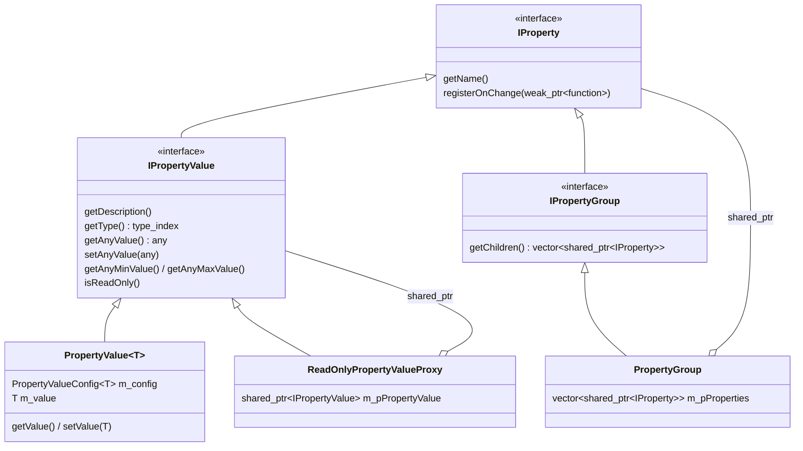

# Properties

This document describes the property system as it is today: the interfaces, the implementations, how owners declare and expose properties, how the GUI consumes them, and how ownership and change notification work. It ends with the known problems of the current design.

- [Overview](#overview)
- [Intent and planned uses](#intent-and-planned-uses)
  - [Intent](#intent)
  - [Planned and possible uses](#planned-and-possible-uses)
  - [Requirements these uses imply](#requirements-these-uses-imply)
- [Libraries](#libraries)
- [Interfaces](#interfaces)
- [Implementations](#implementations)
  - [`PropertyValue<T>`](#propertyvaluet)
  - [`PropertyGroup`](#propertygroup)
  - [`ReadOnlyPropertyValueProxy`](#readonlypropertyvalueproxy)
  - [`PropertyChangeNotifier`](#propertychangenotifier)
- [Usage by owners](#usage-by-owners)
  - [Static properties: `ViewTransform`](#static-properties-viewtransform)
  - [Dynamic properties: `AnariRenderer`](#dynamic-properties-anarirenderer)
  - [Composition into trees](#composition-into-trees)
- [Usage by the GUI](#usage-by-the-gui)
- [Ownership and lifetimes](#ownership-and-lifetimes)
- [Change notification](#change-notification)
- [Known problems](#known-problems)

## Overview

The property system is a small reflection layer. It lets an object expose some of its parameters, with a name, a description, a type and optional bounds, to code that does not know the object's type. Its only consumer today is the ImGui property panel, which draws and edits any property tree.

There are two kinds of properties:

- A **value** (`IPropertyValue`) holds one typed value, accessible type-erased through `std::any`.
- A **group** (`IPropertyGroup`) is a named list of child properties, values or groups, forming a tree.



## Intent and planned uses

### Intent

Properties are not a GUI feature. They are how an object holds the parts of its state it wants to expose, and they are the source of truth for that state:

- **They protect the data.** A property owns its value and enforces its rules, such as min/max bounds, whoever writes to it: the owner itself, im3e code, or user code.
- **They notify changes to anyone.** The owner reacts to external changes through the same mechanism as any other listener. For example, `ViewTransform` invalidates its matrix when one of its properties is changed from outside.
- **They are open to users.** A user can combine the properties im3e provides with their own in one tree, and build on top of it without knowing the concrete classes: their own UI, or any of the uses below.

The ImGui property panel is the first consumer, not the reason the system exists. Design choices should be judged against the uses below, not only against the GUI.

### Planned and possible uses

| Area                     | Use                                                                                           |
| ------------------------ | --------------------------------------------------------------------------------------------- |
| User interfaces          | im3e's ImGui panel, and UIs built by users from im3e's properties and their own.              |
| Observation              | Stats collection: read-only properties such as frame time or loaded tiles.                    |
|                          | Logging and tracing of changes for debugging.                                                 |
| Documentation            | Generating documentation for objects from their names, descriptions, types and bounds.        |
|                          | Exporting values to documents or reports.                                                     |
| Persistence and exchange | Saving and restoring settings, presets or a whole session without code per class.             |
|                          | Mapping properties to OpenUSD attributes, to export and import a scene's parameters.          |
|                          | Overriding values from the command line or a config file, e.g. `--camera.projection.fovY=60`. |
| Changes over time        | Undo/redo, recorded from change notifications.                                                |
|                          | Animation and keyframes: interpolating numeric properties, e.g. camera paths.                 |
|                          | Linking properties, e.g. two views sharing a camera, or one property driving another.         |
| Outside the process      | Scripting, e.g. Python bindings exposing the whole tree through one generic binding.          |
|                          | Remote control or a web UI.                                                                   |
| Tests                    | Snapshots of an object's state, and test inputs generated from min/max ranges.                |

Only the ImGui panel exists today. The others are directions the design should leave room for.

### Requirements these uses imply

Compared to the current design, these uses need:

1. **Stable identifiers, separate from display names.** Persistence, command-line overrides and scripting need an id such as `distanceToTarget` and a path through the tree. Today the only name is display text ("Distance to Target"), and the GUI identifies a property by its address.
2. **Richer metadata:** units (Heading and Tilt are in radians but would be shown in degrees), step or precision, enumerated choices, a category, and whether the value should be persisted (a derived value such as the aspect ratio should not be).
3. **Richer notifications:** the old and new values (undo), the origin of the change (to avoid loops between linked properties), and batching of several changes into one (as ANARI's commit already does).
4. **Typed access through the interfaces**, such as an `IPropertyValue<T>` with `getValue()`/`setValue()`, so that user code which knows the type does not go through `std::any`.
5. **Trees that change.** Adding or removing an object, for example in the world, should notify the listeners of its group.
6. **Safe lifetimes across owners.** When a tree mixes im3e's and users' properties, a consumer that outlives an owner must be able to tell that the property is gone, rather than call into a destroyed object.
7. **Low overhead for frequent updates.** Stats change every frame, and should not pay for `std::any` and a callback list on each update. Read-only metrics may deserve a lighter kind of property.
8. **Thread safety**, if stats collection or remote control read properties from other threads.

Not all of these have to be implemented at once, but the design should not prevent any of them.

## Libraries

A single static target, `im3e_property`, in [im3e/property/](../../im3e/property/):

| Header                                                                                                 | Content                                                                        |
| ------------------------------------------------------------------------------------------------------ | ------------------------------------------------------------------------------ |
| [property_interface.h](../../im3e/property/lib/include/im3e/property/property_interface.h)             | Interfaces: `IProperty`, `IPropertyValue`, `IPropertyGroup`.                   |
| [properties.h](../../im3e/property/lib/include/im3e/property/properties.h)                             | `PropertyValue<T>`, `createPropertyGroup`, `createReadOnlyPropertyValueProxy`. |
| [property_change_notifier.h](../../im3e/property/lib/include/im3e/property/property_change_notifier.h) | `PropertyChangeNotifier`.                                                      |

## Interfaces

Defined in [property_interface.h](../../im3e/property/lib/include/im3e/property/property_interface.h).

| Interface        | Members                                                                                                                                                                      |
| ---------------- | ---------------------------------------------------------------------------------------------------------------------------------------------------------------------------- |
| `IProperty`      | `getName()`, `registerOnChange(std::weak_ptr<std::function<void()>>) const`.                                                                                                 |
| `IPropertyValue` | `getDescription()`, `getType()` (`std::type_index`), `getAnyValue()`, `setAnyValue(std::any)`, `getAnyMinValue()`, `getAnyMaxValue()`, `isReadOnly()` (defaults to `false`). |
| `IPropertyGroup` | `getChildren()`, returning a copy of a `std::vector<std::shared_ptr<IProperty>>`.                                                                                            |

The interfaces are only type-erased: there is no typed interface (an `IPropertyValue<T>` with `getValue()`/`setValue()`). Typed access is only available on the concrete classes.

`getChildren()` returning `shared_ptr`s means that every node of a tree is a heap-allocated, shared object.

## Implementations

### `PropertyValue<T>`

The implementation used by all production code. It is configured at run time by a `PropertyValueConfig<T>`, designed for designated initializers:

```cpp
template <typename T>
struct PropertyValueConfig
{
    const std::string name;
    const std::string description;
    T defaultValue{};
    std::optional<T> minValue{};
    std::optional<T> maxValue{};
    std::function<void(T newValue)> onChange{};
};
```

Behavior:

- The value starts at `defaultValue`, clamped to `[minValue, maxValue]` when `T` has `operator<` (`HasLessThanOperator<T>`).
- `setValue(T)` clamps the new value, and does nothing if the value did not change (before or after clamping). Otherwise it notifies the listeners registered through `registerOnChange`, then calls `onChange(newValue)`.
- `setAnyValue(std::any)` does an `std::any_cast<T>` (throws `std::bad_any_cast` on a type mismatch) and forwards to `setValue`.
- The config is stored as a whole in the property, `onChange` included. The `name`/`description` members are `const`, which makes the config, and so the property, non-assignable.

`onChange` is how owners react to edits made through the type-erased interface (from the GUI). In practice it captures the owner's `this`.

### `PropertyGroup`

Created by `createPropertyGroup(name, children)`, which returns a `std::shared_ptr<IPropertyGroup>`. The class itself is hidden in [property_group.cpp](../../im3e/property/lib/src/property_group.cpp). The children are fixed at creation: there is no way to add or remove one afterwards.

A group has its own `PropertyChangeNotifier`, but nothing ever triggers it: changes of the children are not forwarded to the group's listeners.

### `ReadOnlyPropertyValueProxy`

Created by `createReadOnlyPropertyValueProxy(pValue)`. It holds a `shared_ptr` to the wrapped value and forwards every getter and `registerOnChange` to it. `setAnyValue` throws, and `isReadOnly()` returns `true`, which the GUI uses to disable the control.

This is how an owner exposes a value it computes itself (`ViewTransform`'s vectors, `PerspectiveProjection`'s aspect ratio) while keeping write access through its own typed pointer.

### `PropertyChangeNotifier`

A helper ([property_change_notifier.h](../../im3e/property/lib/include/im3e/property/property_change_notifier.h)) holding a list of `std::weak_ptr<std::function<void()>>`. `notifyChanged()` calls each callback still alive and drops the expired ones. A listener unsubscribes by destroying the `shared_ptr` holding its callback.

Each property holds it as a `mutable` member, so that `registerOnChange` can be `const`.

## Usage by owners

### Static properties: `ViewTransform`

Most owners (`ViewTransform`, `PerspectiveProjection`, `MapCameraController`, `AnariPlane`, `AnariHeightField`) declare a fixed set of properties as members. [view_transform.h](../../im3e/scene/lib/include/im3e/scene/view_transform.h) is representative:

```cpp
class ViewTransform
{
public:
    ViewTransform(std::function<void()> onChanged);
    ViewTransform(const ViewTransform&) = delete;
    ViewTransform(ViewTransform&&) = delete;
    ViewTransform& operator=(const ViewTransform&) = delete;
    ViewTransform& operator=(ViewTransform&&) = delete;

    void setPosition(const glm::vec3& rPosition) { m_pPosition->setValue(rPosition); }
    [[nodiscard]] auto getPosition() const -> glm::vec3 { return m_pPosition->getValue(); }
    [[nodiscard]] auto getProperties() const -> std::shared_ptr<IPropertyGroup> { return m_pPropertyGroup; }
    // ...

private:
    std::shared_ptr<PropertyValue<glm::vec3>> m_pPosition;
    // ... m_pDirection, m_pUp, m_pRight
    std::shared_ptr<IPropertyGroup> m_pPropertyGroup;
};
```

And in [view_transform.cpp](../../im3e/scene/lib/src/view_transform.cpp):

```cpp
ViewTransform::ViewTransform(std::function<void()> onChanged)
  : m_onChanged(std::move(onChanged))
  , m_pPosition(std::make_shared<decltype(m_pPosition)::element_type>(PropertyValueConfig<glm::vec3>{
        .name = "Position",
        .description = "Camera position in world space",
        .defaultValue = glm::vec3(0.0F, 0.0F, 0.0F),
        .onChange = [this](auto) { _onChanged(); },
    }))
  // ... same for Direction, Up, Right
  , m_pPropertyGroup(createPropertyGroup(
        "View Transform",
        {createReadOnlyPropertyValueProxy(m_pPosition), createReadOnlyPropertyValueProxy(m_pDirection),
         createReadOnlyPropertyValueProxy(m_pUp), createReadOnlyPropertyValueProxy(m_pRight)}))
{
}
```

The pattern, shared by all these owners:

1. Each property is a `std::shared_ptr<PropertyValue<T>>` member, built with `std::make_shared` from a `PropertyValueConfig<T>`. The `make_shared<decltype(m_pX)::element_type>` idiom avoids repeating the type.
2. The property *is* the storage of the value: the owner has no separate `glm::vec3 m_position`. Getters and setters forward to `getValue()`/`setValue()`.
3. `onChange` captures `this` to invalidate a cache or flag a change (`_onChanged()`, `m_transformChanged = true`).
4. A `std::shared_ptr<IPropertyGroup>` member groups the properties, optionally through read-only proxies, and is returned by `getProperties()`.
5. Copy and move are deleted, explicitly (`ViewTransform`) or implicitly. Copying would share the properties between the two objects, and moving would leave the `onChange` lambdas pointing to the moved-from object.

### Dynamic properties: `AnariRenderer`

`AnariRenderer::createProperties()` ([anari_renderer.cpp](../../im3e/anari/src/anari_renderer.cpp)) builds its properties from the parameter list reported by the ANARI device, so the set is only known at run time. It switches on the ANARI type to create a `std::shared_ptr<PropertyValue<T>>`, whose `onChange` calls `anariSetParameter` and flags the renderer for a commit. The renderer keeps no reference to them: the returned group is their only owner, and the values only live in the properties and in ANARI.

### Composition into trees

Owners that aggregate other owners build a group of their sub-groups:

```cpp
auto Camera::createProperties() -> std::shared_ptr<IPropertyGroup>
{
    return createPropertyGroup("Camera", {m_projection.getProperties(), m_view.getProperties()});
}
```

`AnariMapCamera` does the same with the controller and the camera, and the viewer application assembles the top-level "Parameters" group from the camera, renderer and world objects.

Some owners keep their group (`getProperties()` returns the same one each time), others build a new one on each call (`createProperties()`).

## Usage by the GUI

[imgui_property_panel.cpp](../../im3e/guis/src/imgui_property_panel.cpp) and [imgui_property_control.cpp](../../im3e/guis/src/imgui_property_control.cpp):

- `ImguiPropertyPanel` holds the root `std::shared_ptr<IPropertyGroup>`, and walks it on every frame, telling groups and values apart with `std::dynamic_pointer_cast`.
- For each value, it creates an `IImguiPropertyControl` on first sight, chosen from a `std::type_index` → factory map (`bool`, `int32_t`, `uint32_t`, `float`, `std::string`, `glm::vec3`, `glm::vec4`, `glm::quat`, `void`). Controls are cached in a map keyed by the property's `shared_ptr`, so the identity of a property is its address.
- Each control holds a `shared_ptr` to its property and a local copy of the value for ImGui to edit. On each frame, it writes the edited value back with `setAnyValue` when the edit is done, then re-reads it with `getAnyValue`. It disables itself when `isReadOnly()`.

The GUI polls: it never calls `registerOnChange`.

## Ownership and lifetimes

Every property object is shared between:

- its owner (the typed `shared_ptr` member),
- the read-only proxy, if any,
- the group(s) containing it,
- the GUI's panel and control caches.

Shared ownership guarantees that the GUI never holds a dangling *property*. It does not guarantee that the property's `onChange` is safe to call: it captures the owner's `this` as a raw pointer. If the owner is destroyed while the panel is still alive, editing the property calls into a destroyed object. Today this works because the owners outlive the panels in the viewer, not because the design prevents it.

## Change notification

There are two independent channels, both fired by `PropertyValue<T>::setValue`, whether the change comes from the owner or from the GUI:

| Channel              | Registered by               | Signature          | Lifetime                             | Used by                           |
| -------------------- | --------------------------- | ------------------ | ------------------------------------ | --------------------------------- |
| `onChange` in config | the owner, at construction  | `void(T newValue)` | as long as the property              | every owner                       |
| `registerOnChange`   | anyone, through `IProperty` | `void()`           | as long as the caller's `shared_ptr` | only the property library's tests |

Changes do not propagate up the tree: a group's listeners are never notified.

## Known problems

Usage:

- **Properties are held in `shared_ptr`**: an owner's properties cannot be plain members. The class cannot have a default copy (it would share state between copies) and in practice deletes copy and move.
- **Verbose declaration**: each property needs `std::make_shared<decltype(m_pX)::element_type>(PropertyValueConfig<T>{...})`, and exposing it read-only needs an extra `createReadOnlyPropertyValueProxy`.
- **Owner callbacks capture `this`**: this alone prevents moving or copying an owner, independently of `shared_ptr`, and is a lifetime hazard when the GUI outlives the owner.
- **Two groupings to keep in sync**: the owner's typed members and the group listing them are declared separately.

Implementation:

- **`PropertyValue<T>` constructor reads a moved-from config**: `m_value(config.defaultValue)` is initialized after `m_config(std::move(config))`, so for types with a non-trivial move (`std::string`) the initial value is empty instead of the default.
- **Observers are notified before the owner**: `setValue` notifies the `registerOnChange` listeners before calling `onChange`, so a listener reading a value derived by the owner (e.g. `ViewTransform`'s matrix) sees the previous one.
- **Group notifications are never fired**, and `registerOnChange` is unused by the GUI.
- **`getChildren()` copies** a vector of `shared_ptr`s on every call, so on every frame for every group in the panel.
